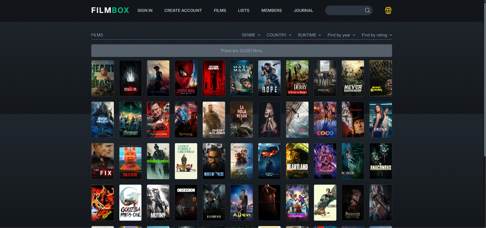
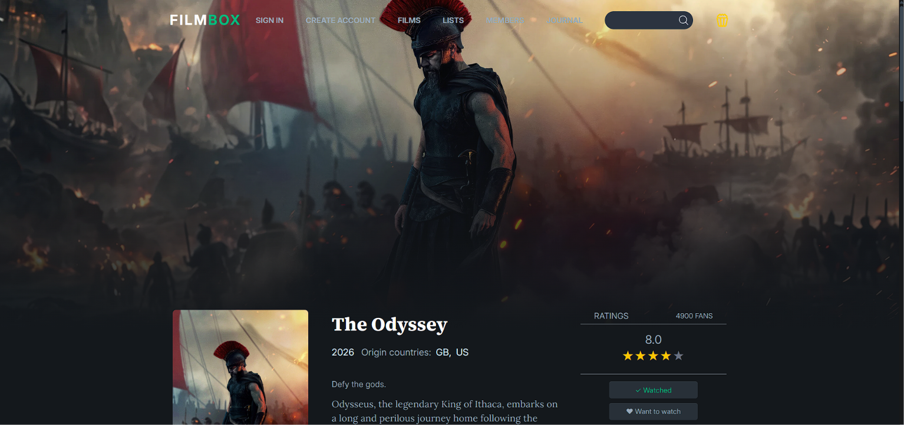
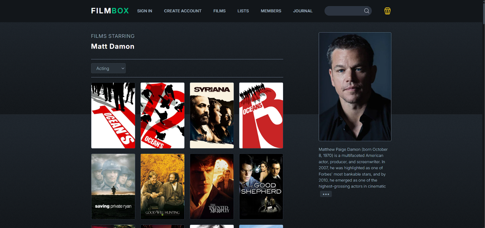
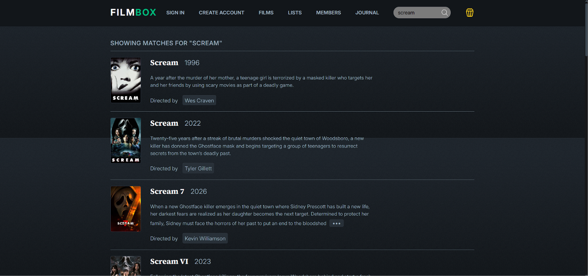

# Filmbox


A movie catalog in the style of Letterboxd, built on the [TMDB](https://www.themoviedb.org) API. Browse and filter films, open film and person pages, search by title and keep a personal watchlist.

**Demo:** https://movie-catalog-main.vercel.app/






## Features

- **Catalog.** Popular films by default; filters by genre, country, runtime, release year and rating; pagination (60 films per page).
- **Film page.** Cast, Crew, Details, Genres and Releases tabs, trailer, reviews, "where to watch" providers, image carousel, similar films.
- **Person page.** Filmography split by department (acting, directing, writing, etc.).
- **Search.** By title, with the director shown for every result.
- **Watchlist.** Statuses _watched / want / dropped_, saved in `localStorage`.

## Tech stack

React 19 · TypeScript · Vite · Tailwind CSS 4 · React Router 7 · Zustand 5 (with `persist`) · lucide-react

## Getting started

Requires Node.js 20.19+ (or 22.13+) and a free [TMDB account](https://www.themoviedb.org/settings/api).

```bash
npm ci
cp .env.example .env      # then put your token into .env
npm run dev
```

`.env`:

```
VITE_TMDB_TOKEN=your_tmdb_api_read_access_token
```

Use the **API Read Access Token** (v4), not the short API key.

| Command              | What it does                                |
| -------------------- | ------------------------------------------- |
| `npm run dev`        | Dev server with HMR                         |
| `npm run build`      | Type check + production build into `dist/`  |
| `npm run preview`    | Serve the production build locally          |
| `npm run lint`       | ESLint                                      |
| `npm test`           | Unit tests (Vitest), single run             |
| `npm run test:watch` | Tests in watch mode                         |

## Tests and CI

```bash
npm test
```

Unit tests use Vitest and cover logic without UI: the total-results calculation (`countTotalResults`), the `tmdbFetch` wrapper (auth header, error handling, request cancellation) and the migration of the persisted watchlist in the Zustand store. The network is mocked in tests, so no TMDB token is needed to run them.

On every push and pull request, GitHub Actions (`.github/workflows/ci.yml`) runs `lint` → `test` → `build` in sequence on Node 22. The status is shown by the badge at the top of this README.

## Project structure

```
src/
├── components/   pages (MainPage, MoviePage, PersonPage, SearchPage, WatchlistPage) and ui/
├── hooks/        data loading: useMovies, useMovie, usePerson, useSearch
├── store/        Zustand: filters (genres, countries) and watchlist
├── lib/tmdb.ts   single place for TMDB requests: base URL, token, error handling
├── types/        TMDB types
├── utils/        pure functions (countTotalResults) and their tests
└── fonts/        Inter, Source Serif 4, Lora (bundled locally)
```

Data hooks cancel in-flight requests with `AbortController` when filters, page or route change, so a slow stale response cannot overwrite a newer one.

## Security note

`VITE_*` variables are embedded in the client bundle, so the TMDB token is visible to anyone who opens DevTools. This is normal for a frontend-only app: use a **read-only** token, never commit `.env` (it is in `.gitignore`), and rotate the token if it leaks. To hide it completely you would need a small proxy (for example a serverless function).

## Known limitations

- Filters and the current page are not stored in the URL, so a filtered view cannot be shared via a link.
- Search makes one extra `/credits` request per result to find the director (up to 20 per page), which can make it slow.
- On a person page opened for a director, the "Acting" department is not offered in the dropdown.
- Switching the page of film reviews reloads the whole film.
- The header has only a "Films" link: sign-in, lists and members are not implemented.

## Attribution

This product uses the TMDB API but is not endorsed or certified by TMDB.
Streaming availability data is provided by JustWatch via TMDB.
The interface is inspired by Letterboxd; the project is not affiliated with it.