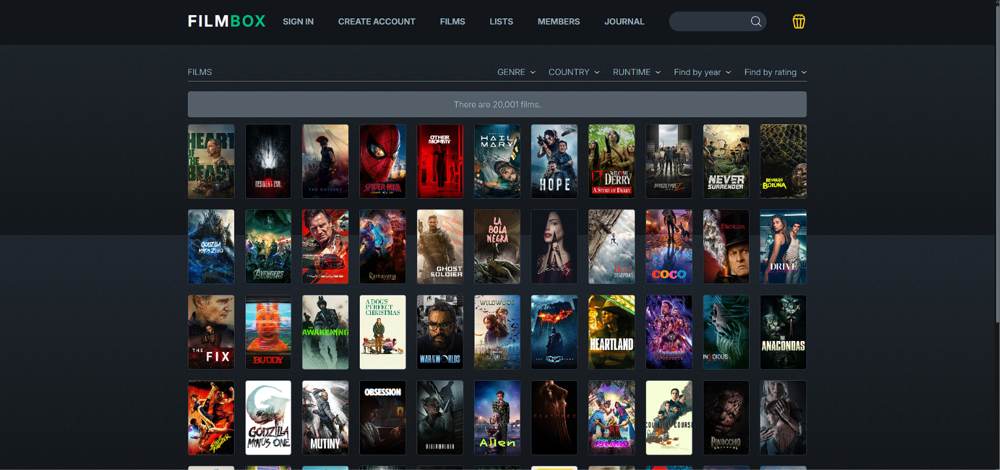
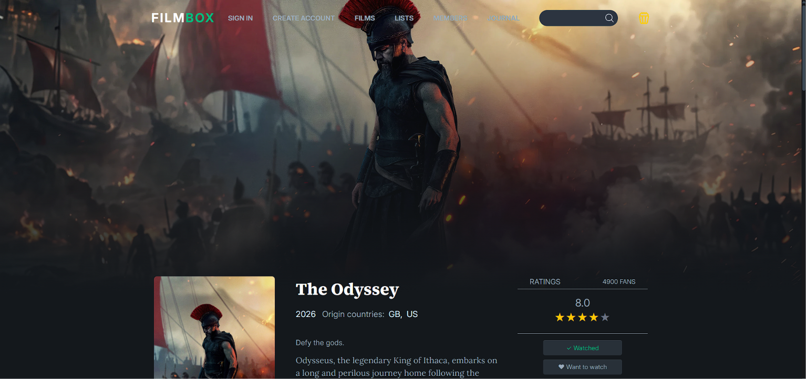
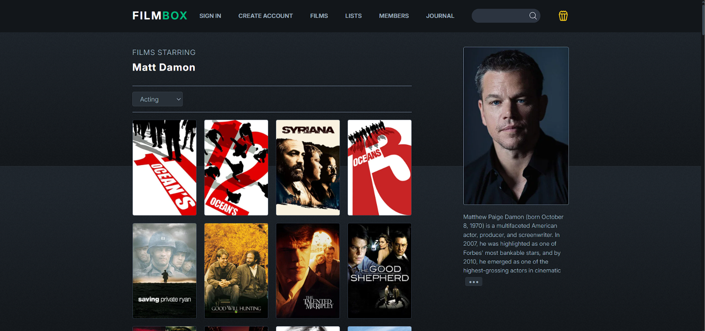
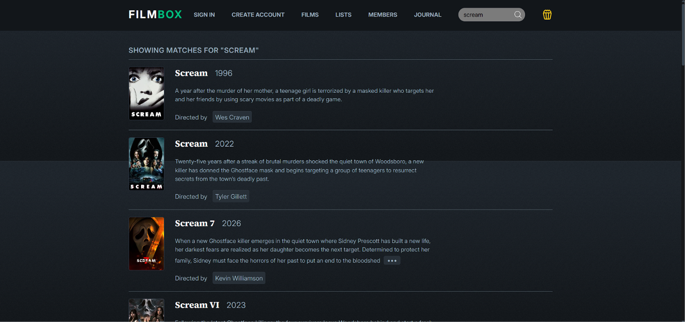

# Filmbox

Каталог фильмов в стиле Letterboxd на базе API [TMDB](https://www.themoviedb.org). Можно просматривать и фильтровать фильмы, открывать страницы фильмов и персон, искать по названию и вести личный вотчлист.

**Демо:** _добавьте ссылку на Vercel_






## Возможности

- **Каталог.** По умолчанию популярные фильмы; фильтры по жанру, стране, длительности, году и рейтингу; пагинация (60 фильмов на страницу).
- **Страница фильма.** Вкладки Cast, Crew, Details, Genres и Releases, трейлер, отзывы, «где смотреть», карусель кадров, похожие фильмы.
- **Страница персоны.** Фильмография по отделам (актёрская работа, режиссура, сценарий и т. д.).
- **Поиск.** По названию, у каждого результата указан режиссёр.
- **Вотчлист.** Статусы _watched / want / dropped_, сохраняются в `localStorage`.

## Стек

React 19 · TypeScript · Vite · Tailwind CSS 4 · React Router 7 · Zustand 5 (с `persist`) · lucide-react

## Запуск

Нужны Node.js 20+ и бесплатный [аккаунт TMDB](https://www.themoviedb.org/settings/api).

```bash
npm ci
cp .env.example .env      # затем впишите токен в .env
npm run dev
```

`.env`:

```
VITE_TMDB_TOKEN=ваш_API_Read_Access_Token
```

Нужен **API Read Access Token** (v4), а не короткий API-ключ.

| Команда                | Что делает                          |
| ---------------------- | ----------------------------------- |
| `npm run dev`          | Dev-сервер с HMR                    |
| `npm run build`        | Production-сборка в `dist/`         |
| `npm run preview`      | Локальный запуск собранной версии   |
| `npx tsc --noEmit`     | Проверка типов (в `build` не входит) |

## Структура проекта

```
src/
├── components/   страницы (MainPage, MoviePage, PersonPage, SearchPage, WatchlistPage) и ui/
├── hooks/        загрузка данных: useMovies, useMovie, usePerson, useSearch
├── store/        Zustand: фильтры (жанры, страны) и вотчлист
├── lib/tmdb.ts   единое место запросов к TMDB: базовый URL, токен, обработка ошибок
├── types/        типы TMDB
└── fonts/        Inter, Source Serif 4, Lora (подключены локально)
```

Хуки загрузки отменяют незавершённые запросы через `AbortController` при смене фильтров, страницы или маршрута, поэтому медленный устаревший ответ не перезапишет новый.

## О безопасности

Переменные `VITE_*` попадают в клиентский бандл, поэтому токен TMDB виден любому, кто откроет DevTools. Для приложения без бэкенда это нормально: используйте токен **только для чтения**, не коммитьте `.env` (он в `.gitignore`) и перевыпустите токен, если он утёк. Чтобы скрыть его полностью, нужен небольшой прокси (например, serverless-функция).

## Известные ограничения

- Фильтры и текущая страница не хранятся в URL, поэтому ссылкой на отфильтрованный список поделиться нельзя.
- На последней странице отфильтрованного списка может показываться кнопка «Next».
- Поиск делает по одному дополнительному запросу `/credits` на каждый результат, чтобы найти режиссёра (до 20 на страницу), из-за чего он может быть медленным; кнопка «Show more» показывается всегда.
- На странице персоны, открытой по режиссёру, в списке отделов нет «Acting».
- Смена страницы отзывов перезагружает весь фильм.
- В шапке только ссылка «Films»: вход, списки и участники не реализованы.
- ESLint настроен только на `.js/.jsx` и не проверяет `.ts/.tsx`.

## Атрибуция

This product uses the TMDB API but is not endorsed or certified by TMDB.
Данные о доступности стриминга предоставлены JustWatch через TMDB.
Интерфейс вдохновлён Letterboxd; проект с ним не связан.